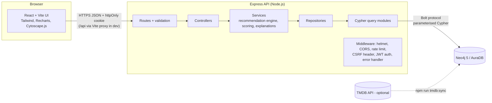
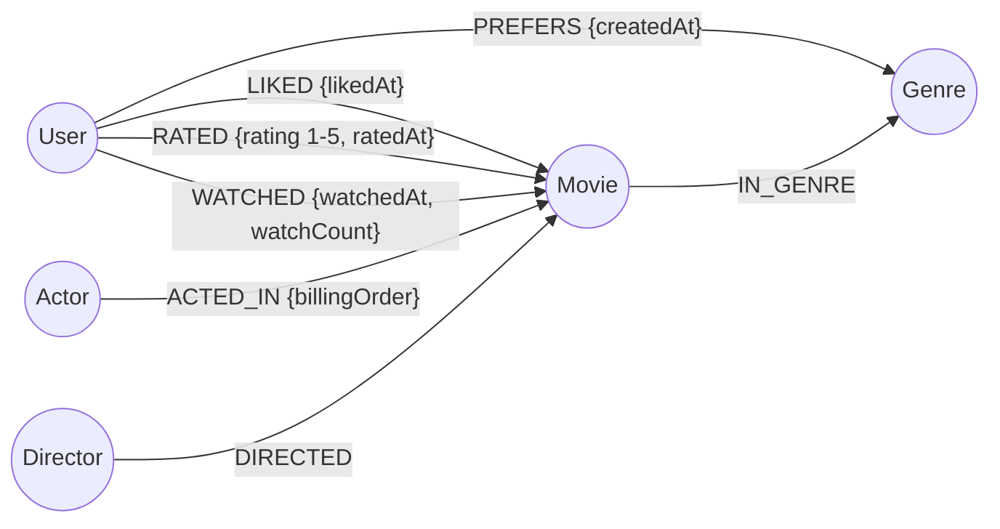

# CineGraph — A Graph-Based Movie Recommendation System Using Neo4j

> **Discover Movies Through Connections.**

CineGraph is a full-stack web application that recommends movies by walking the relationships between
**users, movies, genres, actors and directors** stored in a **Neo4j** graph database. Every
recommendation comes with a truthful, data-backed explanation such as:

> *Recommended because you rated The Dark Knight 4★: it shares director Christopher Nolan, actors
> Christian Bale and Michael Caine and the Drama genre.*

| Layer     | Technology |
|-----------|------------|
| Front end | React 18, Vite 5, Tailwind CSS 3, React Router 6, Axios, Lucide icons, Recharts, Cytoscape.js |
| Back end  | Node.js (≥ 18.18), Express 4 (ES modules), official `neo4j-driver` 5, express-validator, bcryptjs, JWT (httpOnly cookie), helmet, express-rate-limit |
| Database  | Neo4j 5.x / 2025.x or Neo4j AuraDB — Cypher only (tested on Neo4j **5.26 LTS**) |
| Testing   | Vitest + Supertest (unit, API-contract and integration tests) |

A longer project report — abstract, requirements, data flow, pseudocode, sample input/output, test-case
tables and **viva questions and answers** — is in [`docs/PROJECT_REPORT.md`](docs/PROJECT_REPORT.md).

---

## Table of contents

1. [Project title](#1-project-title)
2. [Abstract](#2-abstract)
3. [Problem statement](#3-problem-statement)
4. [Motivation](#4-motivation)
5. [Objectives](#5-objectives)
6. [Scope](#6-scope)
7. [Existing system and its limitations](#7-existing-system-and-its-limitations)
8. [Proposed system](#8-proposed-system)
9. [Technology stack](#9-technology-stack)
10. [System architecture](#10-system-architecture)
11. [Graph database schema](#11-graph-database-schema)
12. [Relationship explanations](#12-relationship-explanations)
13. [Recommendation algorithm](#13-recommendation-algorithm)
14. [Project directory structure](#14-project-directory-structure)
15. [Prerequisites](#15-prerequisites)
16. [Neo4j installation or AuraDB setup](#16-neo4j-installation-or-auradb-setup)
17. [Environment-variable configuration](#17-environment-variable-configuration)
18. [Database constraints and seeding](#18-database-constraints-and-seeding)
19. [Backend installation](#19-backend-installation)
20. [Frontend installation](#20-frontend-installation)
21. [Running the application](#21-running-the-application)
22. [API endpoint documentation](#22-api-endpoint-documentation)
23. [Test instructions](#23-test-instructions)
24. [Screenshots checklist](#24-screenshots-checklist)
25. [Limitations](#25-limitations)
26. [Future enhancements](#26-future-enhancements)
27. [Conclusion](#27-conclusion)
28. [References](#28-references)

Also: [Quick start](#quick-start) · [Demo script for the viva](#demo-script-for-the-viva) ·
[Troubleshooting](#troubleshooting) · [Security notes](#security-notes) · [Data sources and licensing](#data-sources-and-licensing)

---

## Quick start

Windows PowerShell (macOS/Linux: use `cp` instead of `Copy-Item`):

```powershell
# 1. Install dependencies (root, backend, frontend)
npm install
npm run install:all

# 2. Configure the backend - edit NEO4J_PASSWORD and JWT_SECRET afterwards
Copy-Item backend\.env.example backend\.env

# 3. Start Neo4j (Desktop, Docker or AuraDB - see section 16), then create the sample graph
npm run seed

# 4. Start API (http://localhost:5000) and website (http://localhost:5173) together
npm run dev
```

Open **http://localhost:5173** and sign in with a demo account, e.g. **`aarav@cinegraph.demo` / `Demo@1234`**
(the login page also has one-click demo buttons).

---

## 1. Project title

**CineGraph — A Graph-Based Movie Recommendation System Using Neo4j.**

## 2. Abstract

Recommendation systems help users find relevant items in large catalogues. Most student projects store
movies in tables and recommend "top-rated" lists, which ignore how movies, people and users are connected.
CineGraph models the domain as a property graph in Neo4j: users **like**, **rate**, **watch** and
**prefer**; movies belong to **genres** and are linked to their **actors** and **directors**.
Recommendations are produced by Cypher traversals: (A) genre-based, (B) actor/director-based,
(C) graph-based collaborative filtering through users with overlapping tastes, and (D) a hybrid that
combines normalised signals with configurable weights. Each result carries an explanation generated only
from the relationships the query actually found. A React interface provides browsing, filtering,
ratings, a recommendation dashboard, an interactive Cytoscape.js graph explorer and live analytics.

## 3. Problem statement

Design and implement a movie recommendation web application in which recommendations are derived from
the *relationships* between users, movies, genres, actors and directors stored in a graph database, are
explainable to the user, and adapt immediately as the user's likes, ratings and preferences change.

## 4. Motivation

- "Movies by the same director as a film I liked" or "what did people with my taste enjoy" are
  multi-hop relationship questions. In SQL they need several joins; in a graph they are short patterns.
- Users trust recommendations more when they can see *why* something was suggested.
- Neo4j and Cypher are industry tools used for recommendations, fraud detection and knowledge graphs —
  valuable to learn.

## 5. Objectives

1. Model users, movies, genres, actors, directors and interactions as a Neo4j property graph with
   constraints and indexes.
2. Implement four recommendation algorithms (genre, actor/director, collaborative, hybrid) in Cypher.
3. Produce a truthful explanation and a 0–1 relevance score for every recommendation.
4. Handle new users (cold start) without errors or empty pages.
5. Provide a secure REST API (validation, authentication, authorisation, rate limiting).
6. Build a polished, responsive React UI including an interactive graph explorer and analytics.
7. Test the system with automated unit, API and integration tests, and evaluate it offline with
   Precision@K / Recall@K.

## 6. Scope

**In scope:** registration/login, browsing with search, filters, sorting and pagination, movie details,
likes, 1–5 star ratings, watch history, preferred genres, four recommendation strategies with
explanations, related movies, graph exploration, analytics, a repeatable seed script, offline evaluation
and optional TMDB poster import.

**Out of scope:** video streaming, payments, a production-scale catalogue, machine-learned models,
social features (friends, reviews), admin content management.

## 7. Existing system and its limitations

| Typical approach | Limitation |
|---|---|
| "Top rated" or "most popular" lists | Same list for everyone; not personalised |
| Relational tables + many JOINs for "similar" movies | Multi-hop queries become long, slow to write and hard to read |
| Black-box ML recommenders | Hard to explain *why* an item was recommended; need large training data |
| Simple genre filters | Ignore actors, directors and what similar users enjoyed |

## 8. Proposed system

CineGraph stores every fact as a node or relationship and answers recommendation questions with graph
patterns. Four signals — **shared genres, shared actors, shared directors, similar users** — plus a
quality signal (catalogue rating) are each normalised to 0–1 and combined by a documented weighted
formula. Signals that cannot be computed for a user are excluded and the remaining weights rescaled, so
new users still get sensible results. Explanations are assembled only from the shared nodes the query
returned. The graph explorer visualises exactly those relationships.

## 9. Technology stack

| Purpose | Choice | Why |
|---|---|---|
| UI | React 18 + Vite 5 | Component-based UI, fast dev server and build |
| Styling | Tailwind CSS 3 | Consistent design system with utility classes |
| Routing | React Router 6 | Client-side pages with protected routes |
| HTTP | Axios | Interceptors for uniform error handling and cookies |
| Icons / charts | lucide-react / Recharts | Lightweight, MIT licensed |
| Graph view | Cytoscape.js 3 | Mature graph-visualisation library (zoom, pan, layouts, events) |
| API | Node.js + Express 4 (ES modules) | Simple, widely taught REST framework |
| DB driver | `neo4j-driver` 5.28 (official) | Connection pooling, managed transactions with retries |
| Validation | express-validator 7 | Declarative validation and sanitising |
| Passwords | bcryptjs (bcrypt algorithm, 12 rounds) | Pure JavaScript — installs on Windows without native build tools |
| Sessions | JWT in an **httpOnly** cookie | Token unreadable by JavaScript (XSS-resistant) |
| Hardening | helmet, cors (restricted origins), express-rate-limit | Standard Express security middleware |
| Database | **Neo4j 5.x / 2025.x / AuraDB** with Cypher | Native graph storage and pattern queries |
| Tests | Vitest 2 + Supertest 7 | Fast ESM-native test runner and HTTP assertions |

> **Note on bcrypt:** the prompt asked for `bcrypt`. The native `bcrypt` package often fails to install
> on student Windows machines (it needs C++ build tools). `bcryptjs` implements the same bcrypt algorithm
> in pure JavaScript, so it was used instead.

> **Note on Cytoscape integration:** instead of the unmaintained `react-cytoscapejs` wrapper, Cytoscape is
> wrapped in a small React component (`GraphExplorer.jsx`) using `useRef`/`useEffect`. This lets newly
> expanded neighbourhoods merge into the existing graph without rebuilding it.

## 10. System architecture



**Layers**

| Layer | Folder | Responsibility |
|---|---|---|
| Routes | `backend/src/routes` | URL → middleware chain → controller |
| Validators | `backend/src/validators` | Reject bad input with HTTP 400 before touching the DB |
| Middleware | `backend/src/middleware` | Auth, ownership check, CSRF header, rate limits, errors |
| Controllers | `backend/src/controllers` | Read the request, call a service, send JSON |
| Services | `backend/src/services` | Business logic: recommendation engine, scoring, explanations, graph serialisation |
| Repositories | `backend/src/repositories` | Run queries and shape rows |
| Queries | `backend/src/queries` | All Cypher, commented for the viva |
| Config | `backend/src/config` | Environment, Neo4j driver/session helpers, recommendation weights |

**Request flow example — "Get my recommendations":**
`GET /api/recommendations/me` → `requireAuth` verifies the JWT cookie → `authorizeUserParam` swaps `me`
for the token's user id → `recommendationService.loadProfile` runs `USER_TASTE_PROFILE` → four signal
queries run in parallel → scores are normalised and combined → explanations are built → JSON response.

## 11. Graph database schema



**Nodes**

| Label | Properties | Constraint |
|---|---|---|
| `User` | `userId`, `name`, `email`, `passwordHash`, `createdAt` | `userId` unique, `email` unique |
| `Movie` | `movieId`, `title`, `releaseYear`, `overview`, `rating` (0–10), `runtime` (min), `addedAt`, optional `posterPath`, `backdropPath`, `tmdbId` | `movieId` unique |
| `Genre` | `genreId`, `name` | `genreId` unique, `name` unique |
| `Actor` | `actorId`, `name` | `actorId` unique |
| `Director` | `directorId`, `name` | `directorId` unique |

Range indexes: `Movie(title)`, `Movie(releaseYear)`, `Movie(rating)`, `Movie(addedAt)`, `Actor(name)`,
`Director(name)`. Defined in [`backend/src/queries/schemaQueries.js`](backend/src/queries/schemaQueries.js):

```cypher
CREATE CONSTRAINT movie_id_unique IF NOT EXISTS FOR (m:Movie) REQUIRE m.movieId IS UNIQUE;
CREATE INDEX movie_release_year IF NOT EXISTS FOR (m:Movie) ON (m.releaseYear);
```

**Version note:** this is Neo4j 5 syntax (`FOR … REQUIRE`). Neo4j 4.x used
`CREATE CONSTRAINT ON (m:Movie) ASSERT m.movieId IS UNIQUE`, which was removed in Neo4j 5. Queries also
use `COUNT { … }` / `EXISTS { … }` subqueries (Neo4j 5+) and avoid the deprecated `CALL { WITH x … }`
import syntax.

**Design decisions**

- Identifiers are stable readable slugs (`inception-2010`, `christopher-nolan`, `sci-fi`); registered
  users get UUIDs. All writes use `MERGE` on these ids, so re-imports never duplicate data.
- **Popularity is not stored.** It is computed from the graph (number of users who liked, rated or
  watched a movie), so it can never go stale or contradict the interactions.
- The optional `(:Movie)-[:SIMILAR_TO]->(:Movie)` relationship is **not materialised**. Similarity is
  computed live from shared nodes, so there is no second copy of the same fact to keep in sync.
- "Favourite movies" are `LIKED` relationships. Rating and liking are independent facts.
- At most one `LIKED`, `RATED` and `WATCHED` relationship exists per user/movie pair (`MERGE`). Repeat
  views update `WATCHED.watchedAt` and increment `watchCount`.

## 12. Relationship explanations

| Relationship | Meaning | Used by |
|---|---|---|
| `(:User)-[:LIKED]->(:Movie)` | User marked the movie as a favourite | Seeds for every algorithm, similar-user detection |
| `(:User)-[:RATED {rating}]->(:Movie)` | 1–5 stars; **4–5 counts as positive** | Seeds (5★ weight 1.0, 4★ weight 0.8), analytics |
| `(:User)-[:WATCHED]->(:Movie)` | User has seen it | Excluded from recommendations, history page |
| `(:User)-[:PREFERS]->(:Genre)` | Explicitly chosen genre | Cold start and +1.0 genre-profile bonus |
| `(:Movie)-[:IN_GENRE]->(:Genre)` | Movie belongs to genre | Algorithm A, related movies |
| `(:Actor)-[:ACTED_IN]->(:Movie)` | Principal cast credit | Algorithm B |
| `(:Director)-[:DIRECTED]->(:Movie)` | Director credit | Algorithm B |

## 13. Recommendation algorithm

All tuning lives in **one module**: [`backend/src/config/recommendation.js`](backend/src/config/recommendation.js).
The engine is [`backend/src/services/recommendationService.js`](backend/src/services/recommendationService.js);
Cypher is in [`backend/src/queries/recommendationQueries.js`](backend/src/queries/recommendationQueries.js).

### Step 0 — taste profile and eligibility policy

- **Seed movies** = movies the user LIKED or RATED ≥ 4. Weight: like or 5★ = **1.0**, 4★ = **0.8**
  (if both liked and rated, the stronger signal counts once).
- **Excluded** = every movie the user already liked, rated **or** watched. These are never recommended.
- **Genre profile** = for each genre, the sum of seed weights in that genre, **+1.0** if the user prefers it.

### Algorithm A — genre-based

`Seed → Genre ← Candidate`

```cypher
UNWIND $genreWeights AS gw                       // [{genreId, weight}] = taste profile
MATCH (g:Genre {genreId: gw.genreId})<-[:IN_GENRE]-(c:Movie)
WHERE NOT c.movieId IN $excludeIds               // eligibility policy
WITH c, collect(g.name) AS sharedGenres, sum(gw.weight) AS genreRaw
RETURN c.movieId, sharedGenres, genreRaw
```

`genreScore = genreRaw / totalProfileWeight` — the share of the user's taste profile the movie covers (0–1).

### Algorithm B — actor and director

`Seed ← Actor/Director → Candidate`. Rows are grouped by (candidate, person) **before** summing, so an
actor who links the candidate to three of your movies still counts once (with the strongest seed weight).

`actorScore = min(1, Σ shared-actor weights / 2)` (two shared actors = full score);
`directorScore = min(1, Σ shared-director weights / 1)`.

### Algorithm C — graph-based collaborative filtering

1. **Similar users:** other users who liked/rated ≥ 4 any of your seed movies. Similarity is the
   **Jaccard index** of positive sets: `|A ∩ B| / |A ∪ B|` (top 20 kept).
2. **Candidates:** movies those users liked or rated ≥ 4 that you have not consumed. One vote per
   (candidate, user), with strength 1.0 (like/5★) or 0.8 (4★).

`collaborativeScore = Σ(similarity × strength) / Σ similarity` — the similarity-weighted share of your
neighbourhood that endorses the movie (0–1). This is a **graph-based collaborative-filtering heuristic**:
co-occurrence of likes, not a causal or learned model.

### Algorithm D — hybrid

```
finalScore = Σ (weight_c × score_c) / Σ weight_c        over AVAILABLE components c

weights:  genre 0.30 · actor 0.15 · director 0.15 · collaborative 0.25 · rating 0.15
ratingScore = catalogue rating / 10
```

- A component is **unavailable** when it can't be computed (no seeds → no actor/director; no similar
  users → no collaborative). It is removed from numerator *and* denominator, so the score still spans 0–1.
- Only movies connected to the user by at least one graph relationship are candidates, so a high
  catalogue rating alone can never produce a recommendation.
- Ties break by catalogue rating, then title, so results are deterministic and reproducible.
- `matchPercent = round(finalScore × 100)`.

### Explanations

Each item returns `movieId, title, posterPath, finalScore, matchPercent, components, sharedGenres,
sharedActors [{name, via}], sharedDirectors [{name, via}], similarUserCount, headline, reasons`.
The headline names an **anchor** seed movie (director link 3 points, each actor 2, each genre 1) and
lists exactly what the candidate shares with *that* movie. Integration tests re-query Neo4j to confirm
every named director and actor really connects the two movies.

### Cold start

| User state | Mode | Behaviour |
|---|---|---|
| No likes, ratings or preferences | `popular` | Most-engaged movies, clearly labelled "not personalised"; dashboard shows genre picker + popular movies to like |
| Preferred genres only | `preference-based` | Same formula; only genre and rating are available (weights become 0.67 / 0.33) |
| ≥ 1 like or 4★+ rating | `personalised` | All available signals |

Single-algorithm tabs (Genre / Cast & crew / Similar users) use the same formula restricted to that
signal plus rating. If a signal has no evidence they return an empty list with an explanatory message.

### Related movies (movie details page)

`0.40 × genre Jaccard + 0.25 × min(1, sharedActors/2) + 0.20 × sharedDirector + 0.15 × min(1, usersWhoLikedBoth/3)`

### Offline evaluation — Precision@K and Recall@K

`npm run evaluate --prefix backend` ([script](backend/src/scripts/evaluateRecommendations.js)):

1. For each user with ≥ 4 positive movies, order positives by interaction time and **hold out the most
   recent 25 %** (at least one) as the test set.
2. Rebuild the profile **without** the test movies: they are removed from the seeds and from the
   exclusion list, so the engine never sees them. The popularity baseline also ignores the evaluated
   user's own interactions.
3. Recommend K movies; Precision@K = hits / K, Recall@K = hits / |test set|; average over users.

Results measured on the seeded sample graph (7 evaluable users, Neo4j 5.26):

| Method | P@5 | R@5 | P@10 | R@10 |
|---|---|---|---|---|
| Hybrid | 0.086 | 0.190 | 0.071 | 0.333 |
| Genre-based | 0.171 | 0.405 | 0.114 | 0.548 |
| Cast & crew | 0.057 | 0.119 | 0.043 | 0.190 |
| Collaborative | 0.000 | 0.000 | 0.014 | 0.071 |
| Popularity baseline | 0.057 | 0.143 | 0.029 | 0.143 |

**Interpretation (honest):** with 7 users and 2–3 test movies each, a single hit changes these numbers
a lot, so they are **not a benchmark**. They show the procedure works. On this data the pure genre
strategy beats the hybrid, because demo users mostly hold out movies in their favourite genres.
Collaborative filtering is weak because only 8 users exist. The weights were **not** tuned to this test
set (that would leak test information).

## 14. Project directory structure

```
cinegraph/
├── README.md                     ← this file
├── docs/PROJECT_REPORT.md        ← report, test cases, viva Q&A
├── package.json                  ← root scripts (install:all, seed, dev, test, build)
├── .gitignore
├── backend/
│   ├── package.json  .env.example  vitest.config.js  vitest.integration.config.js
│   ├── src/
│   │   ├── server.js             ← starts HTTP server, verifies Neo4j, graceful shutdown
│   │   ├── app.js                ← Express app (helmet, CORS, JSON, cookies, routes, errors)
│   │   ├── config/               ← env.js, neo4j.js (driver + session helpers), recommendation.js (weights)
│   │   ├── data/                 ← movies.js (80 films), genres.js (15), users.js (8 demo users)
│   │   ├── queries/              ← schema, movie, user, recommendation, graph, analytics Cypher
│   │   ├── repositories/         ← run queries, shape rows
│   │   ├── services/             ← recommendationService, scoring, explanations, graph, auth, ...
│   │   ├── controllers/          ← HTTP handlers
│   │   ├── routes/               ← Express routers
│   │   ├── middleware/           ← auth, csrf, validate, rate limiters, error handler
│   │   ├── validators/           ← express-validator rules
│   │   ├── utils/                ← ApiError, asyncHandler, response, neo4jTransform, slugify
│   │   └── scripts/              ← createConstraints, seedDatabase, evaluateRecommendations, syncTmdbPosters
│   └── tests/
│       ├── unit/                 ← scoring, explanations, seed data, evaluation, API contract, engine
│       └── integration/          ← real Neo4j: seeding, movies, interactions, recommendations
└── frontend/
    ├── package.json  .env.example  index.html  vite.config.js  tailwind.config.js  postcss.config.js
    ├── public/favicon.svg
    └── src/
        ├── main.jsx  App.jsx
        ├── components/
        │   ├── layout/           ← Navbar, Footer, Layout, Logo
        │   ├── common/           ← LoadingSpinner, ErrorMessage, EmptyState, ProtectedRoute, Skeleton, SectionHeader
        │   ├── movies/           ← MovieCard, MovieGrid, MovieRow, Poster, SearchBar, FilterPanel, GenreBadge,
        │   │                       RatingStars, FavoriteButton, FeaturedCarousel
        │   ├── recommendations/  ← RecommendationCard, RecommendationExplanation, ScoreBreakdown,
        │   │                       GenrePicker, SimilarUsersPanel
        │   └── graph/            ← GraphExplorer (Cytoscape), GraphLegend, NodeDetailsPanel, graphStyles
        ├── pages/                ← Home, Explore, MovieDetails, Login, Register, Profile,
        │                           Recommendations, Graph, Analytics (+About), NotFound
        ├── context/              ← AuthContext, ToastContext
        ├── hooks/                ← useAsync, useDebounce
        ├── services/api.js       ← Axios client for every endpoint
        ├── utils/                ← format.js, poster.js
        └── styles/index.css
```

## 15. Prerequisites

| Software | Version | Notes |
|---|---|---|
| Node.js | **18.18 or newer** (tested with 22) | includes npm |
| Neo4j | **5.x** (5.26 LTS recommended) or 2025.x, or **AuraDB Free** | Community Edition is fine |
| Git | any | optional, for cloning |
| Browser | recent Chrome, Edge or Firefox | |
| Hardware | 4 GB RAM minimum (8 GB recommended with Neo4j Desktop), ~1 GB disk | |

## 16. Neo4j installation or AuraDB setup

Choose **one** option.

**Option A — Neo4j Desktop (Windows/macOS/Linux, easiest offline)**
1. Install Neo4j Desktop from https://neo4j.com/download/.
2. Create a project → *Add* → *Local DBMS*, set a password, choose a **5.x** version and start it.
3. Use `NEO4J_URI=neo4j://localhost:7687`, `NEO4J_USERNAME=neo4j`, your password, `NEO4J_DATABASE=neo4j`.

**Option B — Docker**
```bash
docker run -d --name cinegraph-neo4j -p 7474:7474 -p 7687:7687 \
  -e NEO4J_AUTH=neo4j/your-strong-password neo4j:5.26-community
```
(PowerShell: put the command on one line or replace `\` with a backtick.) Browser UI: http://localhost:7474.

**Option C — Neo4j AuraDB Free (cloud, no install)**
1. Create a free instance at https://console.neo4j.io and **download the credentials file** (the password
   is shown only once).
2. Use `NEO4J_URI=neo4j+s://<instance-id>.databases.neo4j.io`, `NEO4J_USERNAME` from the file (usually
   `neo4j`), the generated password and `NEO4J_DATABASE=neo4j`.

**Connection strings explained**

| Scheme | TLS | Use |
|---|---|---|
| `neo4j://` / `bolt://` | no | Local Desktop/Docker. `neo4j://` supports clusters, `bolt://` connects directly |
| `neo4j+s://` / `bolt+s://` | yes, verified certificate | **AuraDB (mandatory)** |
| `neo4j+ssc://` | yes, self-signed accepted | Self-hosted servers with self-signed certificates |

Community Edition and AuraDB Free have a single user database called **`neo4j`**.

## 17. Environment-variable configuration

`backend/.env` (copy from [`backend/.env.example`](backend/.env.example)):

| Variable | Example | Purpose |
|---|---|---|
| `NODE_ENV` | `development` | `production` enables secure cookies and hides error details |
| `PORT` | `5000` | API port |
| `CLIENT_URL` | `http://localhost:5173` | Comma-separated origins allowed by CORS |
| `NEO4J_URI` | `neo4j://localhost:7687` | See table above |
| `NEO4J_USERNAME` | `neo4j` | |
| `NEO4J_PASSWORD` | *(secret)* | Never commit |
| `NEO4J_DATABASE` | `neo4j` | |
| `JWT_SECRET` | *(≥ 32 random chars)* | Generate: `node -e "console.log(require('crypto').randomBytes(48).toString('hex'))"` |
| `JWT_EXPIRES_IN` | `7d` | Session length |
| `COOKIE_SAMESITE` | `lax` | Use `none` (needs HTTPS) only when front end and API are on different sites |
| `TMDB_READ_ACCESS_TOKEN` | *(optional)* | Only for `npm run tmdb:sync` |

`frontend/.env` (optional, from [`frontend/.env.example`](frontend/.env.example)): `VITE_API_URL=/api`.
Every `VITE_` variable is bundled into public JavaScript, so **never put secrets there**. The Neo4j
password and JWT secret exist only in `backend/.env`.

## 18. Database constraints and seeding

```powershell
cd backend
npm run db:constraints   # constraints + indexes only (optional - seed does this too)
npm run seed             # create/update the sample graph (idempotent)
npm run seed:reset       # ⚠ deletes ALL data in the database, then seeds
```

The seed script ([`backend/src/scripts/seedDatabase.js`](backend/src/scripts/seedDatabase.js)) creates
constraints first, then sends rows in batches of 100 with `UNWIND … MERGE`, reports created counts and
prints a clear message if Neo4j is unreachable. Output on an empty database (actual run):

```
✓ 7 constraints and 6 indexes ensured (13 newly created)
✓ Genres                   15 rows processed · 15 nodes created · 0 relationships created
✓ Movies                   80 rows processed · 80 nodes created · 0 relationships created
✓ Movie → Genre           220 rows processed · 0 nodes created · 220 relationships created
✓ Actors + ACTED_IN       268 rows processed · 178 nodes created · 268 relationships created
✓ Directors + DIRECTED     87 rows processed · 41 nodes created · 87 relationships created
✓ Users                     8 rows processed · 8 nodes created · 0 relationships created
✓ User → PREFERS           18 rows processed · 0 nodes created · 18 relationships created
✓ User → WATCHED           62 rows processed · 0 nodes created · 62 relationships created
✓ User → LIKED             38 rows processed · 0 nodes created · 38 relationships created
✓ User → RATED             26 rows processed · 0 nodes created · 26 relationships created
Graph now holds: 80 movies, 15 genres, 178 actors, 41 directors, 8 users, 719 relationships
```

Running it again reports **0 nodes and 0 relationships created**.

**Demo users** (password `Demo@1234` for all):

| Email | Persona | What to show |
|---|---|---|
| aarav@cinegraph.demo | Sci-fi & Christopher Nolan | Director + actor explanations; Priya is his most similar user |
| priya@cinegraph.demo | Space epics & Villeneuve | Overlaps with Aarav (collaborative filtering) |
| rohan@cinegraph.demo | Crime sagas | Crime/drama recommendations |
| sneha@cinegraph.demo | Animation & family | A completely different taste cluster |
| kabir@cinegraph.demo | Leonardo DiCaprio fan | Actor-based recommendations |
| meera@cinegraph.demo | Horror & mystery | Jordan Peele / Fincher links |
| ananya@cinegraph.demo | Fantasy & adventure | Lord of the Rings, Spielberg |
| ishaan@cinegraph.demo | **New user, no data** | Cold start: popular → preference-based → personalised |

## 19. Backend installation

```powershell
cd backend
npm install
Copy-Item .env.example .env      # macOS/Linux: cp .env.example .env
# edit .env: NEO4J_PASSWORD, JWT_SECRET
npm run seed
npm run dev                      # nodemon, http://localhost:5000/api
```

Check it: open http://localhost:5000/api/health → `{"success":true,"data":{"status":"ok","database":"connected",...}}`.

## 20. Frontend installation

```powershell
cd frontend
npm install
npm run dev                      # http://localhost:5173 (proxies /api to :5000)
npm run build                    # production build into frontend/dist
```

## 21. Running the application

From the project root, `npm run dev` starts both servers (via `concurrently`). Or run
`npm run dev:backend` and `npm run dev:frontend` in two terminals. Start Neo4j first. If it is not
running, the API still starts, `/api/health` returns 503 and pages show a friendly error.

### Demo script for the viva

1. **Home** — featured carousel (←/→ keys or swipe), trending, highest rated, genres, recently added.
2. **Explore** — choose Sci-Fi + minimum rating 8 + sort by year. Point out that the URL changes and the
   API runs Cypher with these parameters.
3. **Sign in as Aarav** → **For You**. Open "Why this movie?" on *The Prestige*: shared director
   (Nolan), shared actors (Bale, Caine), score bars and weights.
4. Switch tabs: Genre-based, Cast & crew, Similar users (Priya, similarity 0.33).
5. **Change behaviour:** open *Dune*, click *Add to favourites*, return to For You — the list changes and
   Dune disappears (already liked).
6. **Graph** → *Explore connections* from any movie: click a node to highlight neighbours,
   double-click/Expand to load more, Fit/Zoom/Reset controls, "My graph".
7. **Cold start:** sign in as Ishaan → popular picks → choose genres → preference-based → like a movie →
   personalised.
8. **Insights** — live counts and charts from Cypher; About section.
9. Neo4j Browser: run `MATCH (m:Movie {movieId:'inception-2010'})-[r]-(n) RETURN m, r, n`.

## 22. API endpoint documentation

Base URL `http://localhost:5000/api`. Success: `{ "success": true, "data": …, "meta"?: … }`.
Error: `{ "success": false, "error": { "code", "message", "details"? } }`.
State-changing requests (POST/PUT/DELETE) must send header **`X-CineGraph-Client: web`** (CSRF protection).
🔒 = requires the session cookie. `:userId` must be `me` or your own id, otherwise **403**.

| Method & path | Auth | Description |
|---|---|---|
| `GET /health` | | API and Neo4j status (503 if DB down) |
| `POST /auth/register` | | `{name, email, password}` → 201 + session cookie |
| `POST /auth/login` | | `{email, password}` → session cookie (generic error on failure) |
| `POST /auth/logout` | | Clears cookie |
| `GET /auth/me` | 🔒 | Current user (401 if not signed in) |
| `GET /auth/session` | | Current user or `null` (never 401) |
| `GET /movies` | | `q, genre (comma list), yearFrom, yearTo, minRating, sort (rating\|title\|year\|added\|popularity), order (asc\|desc), page, limit ≤ 48` |
| `GET /movies/search?q=` | | Title search, prefix matches first, `limit ≤ 20` |
| `GET /movies/trending` | | Most-engaged movies |
| `GET /movies/meta` | | Genres with counts + year range (for filters) |
| `GET /movies/:movieId` | optional | Details, cast, directors, community stats, `userState` if signed in |
| `GET /movies/:movieId/related` | | Related movies with score and reasons |
| `GET /genres` | | All genres with movie counts |
| `GET /recommendations/:userId` | 🔒 | Hybrid (`limit ≤ 50`) |
| `GET /recommendations/:userId/hybrid` | 🔒 | Same as above |
| `GET /recommendations/:userId/genre` | 🔒 | Algorithm A |
| `GET /recommendations/:userId/people` | 🔒 | Algorithm B (actors + directors) |
| `GET /recommendations/:userId/collaborative` | 🔒 | Algorithm C |
| `GET /recommendations/:userId/similar-users` | 🔒 | Jaccard-similar users |
| `GET /users/:userId/profile` | 🔒 | Stats, behaviour-derived top genres, preferences |
| `POST /users/:userId/likes/:movieId` | 🔒 | Like (idempotent) → 201 |
| `DELETE /users/:userId/likes/:movieId` | 🔒 | Unlike |
| `POST` or `PUT /users/:userId/ratings/:movieId` | 🔒 | `{rating: 1-5 integer}` (upsert) |
| `DELETE /users/:userId/ratings/:movieId` | 🔒 | Remove rating |
| `POST /users/:userId/watch-history/:movieId` | 🔒 | Record a view → 201 |
| `GET /users/:userId/favorites` \| `/history` \| `/ratings` | 🔒 | Lists, `limit ≤ 100` |
| `GET /users/:userId/preferences` | 🔒 | Preferred genres |
| `PUT /users/:userId/preferences` | 🔒 | `{genreIds: ["sci-fi", …]}` (replaces all) |
| `GET /graph/movie/:movieId` | optional | Cytoscape elements: movie, genres, cast, directors, related movies, a few users. `relatedLimit ≤ 20`, `userLimit ≤ 10` |
| `GET /graph/neighborhood/:type/:id` | optional | One-hop expansion for `movie\|genre\|actor\|director\|user`, paged with `offset`/`limit ≤ 50`. `user` only for yourself |
| `GET /analytics/overview` | | Node and relationship counts |
| `GET /analytics/genres` | | Movies, likes, ratings and preferences per genre |
| `GET /analytics/top-movies` | | Catalogue top + community top (≥ 2 ratings) |
| `GET /analytics/rating-distribution` | | Ratings per star (1–5) |
| `GET /analytics/people` | | Most-connected actors/directors |
| `GET /analytics/decades` | | Movies per decade |

Status codes: 200, 201, 400 (validation), 401, 403, 404, 409 (duplicate), 413, 429 (rate limit), 500, 503 (DB unavailable).

Example (curl, Git Bash/macOS/Linux):
```bash
curl -c jar -H "X-CineGraph-Client: web" -H "Content-Type: application/json" \
     -d '{"email":"aarav@cinegraph.demo","password":"Demo@1234"}' http://localhost:5000/api/auth/login
curl -b jar "http://localhost:5000/api/recommendations/me?limit=3"
```
In Postman, enable cookies and add the `X-CineGraph-Client: web` header to POST/PUT/DELETE requests.

## 23. Test instructions

```powershell
cd backend
npm test                    # unit + API-contract tests - no database needed (Neo4j is mocked)
npm run test:integration    # ⚠ needs Neo4j from .env; RE-SEEDS it and creates/deletes test users
npm run evaluate            # Precision@K / Recall@K report
cd ..\frontend; npm run build
```

**Results from the development environment** (Node 22, Neo4j 5.26.32 Community, run while building this project):

| Suite | Result |
|---|---|
| `npm test` — 6 files | **53 / 53 passed** |
| `npm run test:integration` — 4 files | **25 / 25 passed** |
| `npm run build` (frontend) | **succeeded** |
| Scripted browser walkthrough (Playwright, all routes, desktop + mobile) | all pages rendered, **no console errors** |

These are the results of the actual runs, not projections. Re-run them on your machine before the demo.

**What is covered**

| Requirement | Test |
|---|---|
| Neo4j connectivity | `integration/database.test.js` |
| Seeding + no duplicates on rerun | `integration/database.test.js`, `unit/seedData.test.js` |
| Movie search, genre filter, year/rating filters, pagination | `integration/movies.test.js` |
| Like/unlike (idempotent), rating upsert, watch count, preferences | `integration/interactions.test.js` |
| Rating validation (0, 6, 4.5, "five", null) | `unit/api.test.js` |
| Genre, actor/director, collaborative, hybrid recommendations | `integration/recommendations.test.js` |
| Exclusion of consumed movies, ranking order, truthful explanations | `integration/recommendations.test.js` |
| Empty state / cold start for new users | `integration/recommendations.test.js`, `unit/recommendationService.test.js` |
| Invalid requests, 401/403, CSRF, malformed JSON, 404 | `unit/api.test.js` |
| Database unavailable → 503 without stack traces | `unit/api.test.js` |
| No e-mail/password hash in graph output | `unit/api.test.js` |
| Scoring maths, renormalisation, explanations | `unit/scoring.test.js`, `unit/explanations.test.js` |

The manual testing checklist is in [`docs/PROJECT_REPORT.md`](docs/PROJECT_REPORT.md#9-test-cases).

## 24. Screenshots checklist

Capture these for the report (none are bundled):

- [ ] Home page (featured carousel + rows)
- [ ] Explore with filters applied
- [ ] Movie details (cast, rating stars, related movies with reasons)
- [ ] Login page with demo accounts
- [ ] Recommendation dashboard with an expanded "Why this movie?" panel
- [ ] Similar users panel
- [ ] Cold-start onboarding (new user)
- [ ] Graph explorer with a selected node highlighted
- [ ] Graph after expanding a node
- [ ] Insights page charts
- [ ] Neo4j Browser showing the graph and a Cypher query
- [ ] Terminal: seed output, test results, evaluation report
- [ ] Mobile view

## 25. Limitations

- **Small curated dataset** (80 movies, 8 demo users). Collaborative filtering and the offline metrics have
  little evidence and are illustrative only.
- Runtimes and ratings are **approximate sample metadata**, not an official feed. Cast lists contain
  principal actors only.
- Similarity is computed per request. Fine for this scale; millions of users would need precomputed
  similarity (e.g. Neo4j Graph Data Science) and caching.
- Weights are hand-chosen and explainable, not learned. On this data the genre-only strategy scored higher
  offline than the hybrid.
- Title search uses `CONTAINS` on lower-cased titles, which does not use an index. A full-text index would
  be needed for a large catalogue.
- Liking and rating are tracked separately; a dislike (≤ 2★) only excludes a movie, it does not push
  similar movies down.
- The graph explorer shows other users by first name and last initial. A real product would anonymise
  further.
- Concurrent duplicate requests rely on `MERGE`. Neo4j cannot enforce "one relationship per pair" with a
  constraint.
- No e-mail verification or password reset.

## 26. Future enhancements

- Import a larger licensed dataset (e.g. TMDB metadata within its terms) and real-time trending windows.
- Neo4j Graph Data Science: node similarity, PageRank, community detection, link prediction.
- Learn the hybrid weights from data with proper train/validation/test splits.
- Negative feedback ("not interested"), diversity and novelty re-ranking.
- Reviews, friends/following, watch-lists, notifications.
- Password reset, e-mail verification, OAuth login, refresh-token rotation.
- Docker Compose for one-command setup and CI with GitHub Actions.

## 27. Conclusion

CineGraph shows that a graph database is a natural fit for recommendations: the questions "what shares a
director with what I liked?" and "what did people like me enjoy?" become short, readable Cypher patterns,
and the same relationships power transparent explanations and an interactive visualisation. The project
combines a secure Express API, a documented and tested hybrid scoring model, and a polished React
interface. It is honest about its limits: a small sample dataset and hand-tuned weights.

## 28. References

1. Neo4j Documentation — Cypher Manual: https://neo4j.com/docs/cypher-manual/current/
2. Neo4j JavaScript Driver Manual: https://neo4j.com/docs/javascript-manual/current/
3. Neo4j Operations Manual — constraints and indexes: https://neo4j.com/docs/cypher-manual/current/constraints/
4. Neo4j AuraDB: https://neo4j.com/docs/aura/
5. Robinson, Webber & Eifrem, *Graph Databases*, 2nd ed., O'Reilly, 2015.
6. Ricci, Rokach & Shapira (eds.), *Recommender Systems Handbook*, Springer.
7. Jaccard similarity — Manning, Raghavan & Schütze, *Introduction to Information Retrieval*, CUP, 2008.
8. Express: https://expressjs.com · React: https://react.dev · Vite: https://vitejs.dev
9. Cytoscape.js: Franz et al., "Cytoscape.js: a graph theory library for visualisation and analysis",
   *Bioinformatics* 32(2), 2016 — https://js.cytoscape.org
10. OWASP Cheat Sheets (authentication, password storage, CSRF): https://cheatsheetseries.owasp.org
11. TMDB API terms and attribution: https://www.themoviedb.org/api-terms-of-use

---

## Troubleshooting

| Symptom | Fix |
|---|---|
| `Could not reach Neo4j at neo4j://localhost:7687` | Start the DBMS in Neo4j Desktop / `docker start cinegraph-neo4j`; check the port |
| `Neo4j rejected the username/password` | Fix `NEO4J_USERNAME` / `NEO4J_PASSWORD` in `backend/.env` |
| AuraDB connection hangs or fails | Use `neo4j+s://`; resume a paused free instance in the Aura console |
| `Database "x" does not exist` | Community/AuraDB Free: use `NEO4J_DATABASE=neo4j` |
| `Invalid configuration: JWT_SECRET …` | Set a random string of ≥ 32 characters |
| Website shows "Cannot reach the CineGraph API" | Start the backend (`npm run dev:backend`) on port 5000 |
| Login works but you are logged out on refresh | Use the Vite dev URL http://localhost:5173 (same-origin proxy); if API and site are on different sites, use HTTPS and `COOKIE_SAMESITE=none` |
| `Missing x-cinegraph-client header` in Postman | Add header `X-CineGraph-Client: web` |
| `429 Too many attempts` | Auth rate limit (20 per 15 min); wait or restart the API in development |
| PowerShell blocks `npm` scripts | `Set-ExecutionPolicy -Scope CurrentUser RemoteSigned` |
| Port 5000 busy (e.g. macOS AirPlay) | Set `PORT=5001` in `backend/.env` and change the proxy target in `frontend/vite.config.js` |
| Demo data changed during a demo | `npm run seed` restores the demo relationships; `npm run seed:reset` rebuilds everything (deletes all data) |

## Security notes

- Passwords hashed with bcrypt (12 rounds). Hashes never leave the service layer.
- JWT stored in an **httpOnly**, `SameSite` cookie (`Secure` in production). Identity always comes from
  the verified token, never from a client-supplied user id.
- CSRF defence: unsafe methods require the `X-CineGraph-Client` header; CORS only allows `CLIENT_URL`.
- Login returns the same message for unknown e-mails and wrong passwords, and runs a dummy bcrypt comparison
  so response timing is similar. Registration conflicts use a neutral message.
- Rate limiting: auth 20 requests / 15 min per IP; API 300 / min.
- All Cypher is parameterised. The only dynamic fragments (sort order, node label) come from server-side
  whitelists.
- Input validation on every parameter, a 20 kB JSON body limit, pagination caps and helmet headers.
- Errors never include stack traces; database outages return 503.
- Graph responses whitelist node properties; other users appear as "First L." and cannot be expanded.

## Data sources and licensing

- **Movie catalogue:** curated for this project. Titles, years, directors and principal cast are public
  facts. Synopses are original short summaries. Runtimes and ratings are approximate sample values.
- **MovieLens** was considered but not bundled: the GroupLens licence does not allow redistribution
  without permission.
- **Posters:** none are bundled. The UI draws generated artwork. `npm run tmdb:sync` (optional, needs your
  own free TMDB token) stores TMDB image paths; images load from TMDB's CDN and the app shows the required
  notice: *"This product uses the TMDB API but is not endorsed or certified by TMDB."* The sync script was
  not run during development (no TMDB token was available), so treat it as untested.
- Fonts: Inter and Space Grotesk (SIL Open Font License) via Google Fonts.
